# vibe-coding-website-builder

A website builder skill for vibe coding: build, check and publish a website or a full web app with AI, without writing code.

It is an agent skill for Claude Code and other AI coding agents. It builds a simple site from a plain description, or a complete app with sign-in, roles, a database and tested rules. It scores any AI-built site from 0 to 100 on whether it is ready to publish, and walks the owner through putting it online.

<p align="center">
  
</p>

Website: [mr-imran.github.io/vibe-coding-website-builder](https://mr-imran.github.io/vibe-coding-website-builder/)

## Install

```sh
npx skills add mr-Imran/vibe-coding-website-builder
```

That uses the [skills CLI](https://github.com/vercel-labs/skills), which installs into Claude Code, Codex, Cursor, OpenCode and other agents that read `SKILL.md`. The bundled check needs Python 3.8 or newer and nothing else; without Python the agent works through the same checklist by hand.

Claude Code can also install it as a plugin:

```sh
claude plugin marketplace add mr-Imran/vibe-coding-website-builder
claude plugin install vibe-coding-website-builder@vibe-coding-website-builder
```

Then open an empty folder and say what you want:

```text
I want a website for my cake business. I don't know anything about coding.
```

## What it does

| You say | What you get |
|---|---|
| "Make me a website for..." | A site made of plain files, with no tools to install, that opens by double-clicking `index.html`. Built around the one thing a visitor should do: call, write, book or buy. |
| "Make me an app / a booking system / a portal for..." | A complete web app: one Node.js program with its database in one file and no packages to install. Sign-in, roles, your business rules enforced on the server, and tests that prove them. |
| A list of requirements or a marking scheme | Each item mapped to what was built and the test that proves it, in a table. |
| "Is my site OK to publish?" | A score out of 100 and a list of what to fix, most important first, described by what a visitor would see go wrong. Nothing is changed unless you ask. |
| "Add a contact form / payment / booking" | The steps to open an account with a hosted service, and the page wired to the link it gives you. No key that should stay secret ever goes in the page. |
| "How do I put it online?" | One recommended free host with its catch, and numbered steps for your browser. |

Whatever only you know (your opening hours, your prices, your photos) is marked on the page with a bright yellow note instead of being made up. You see the gaps in the browser, answer them in chat, and the check counts every note that is left.

## The score

| Area | Points | What is checked |
|---|---|---|
| Safe to publish | 30 | No secret keys in the files, no private files in the folder that goes online, no pretend password protection, nothing sent over an insecure address |
| Everything works | 25 | A home page called `index.html`, every linked picture and page exists with the exact same capital letters, no addresses that only work on your computer, no dead buttons, every form really sends |
| Fits a phone | 10 | The line that tells phones to fit the page, a layout that adapts, nothing fixed wider than a phone |
| Real content | 15 | No placeholder text or pictures, no open yellow notes, no leftover default titles, a way for visitors to act |
| Found and shared | 12 | A title and description for search results, a browser-tab icon, a title and picture for shared links |
| Easy and fast | 8 | Picture descriptions, form labels, zoom allowed, no heavy pictures |

The verdict is one of three: **ready**, **not yet**, or **do not publish** (a secret key, a private file or a pretend password was found).

The score is a checklist of common faults in the files. It does not judge the design, and it cannot tell whether visitors will come. Reviews, customer numbers and similar claims are listed for the owner to confirm, because only they know whether those are true.

## Apps: the sixteen requirements

When a project needs accounts, saved data or rules, the skill builds an app from a starter kit that ships with it: one Node.js program (22.13 or newer), a database in one file, nothing to install. Sign-in, sessions, roles and the helpers that are easy to get wrong are already written and tested.

Every app meets the eight mandatory requirements. The advanced ones are built when you ask for them or the app needs them. Each has a named test, and a requirement only counts as met when the app's own test for it passes.

| | Mandatory, every app | | Advanced, on request | Its test |
|---|---|---|---|---|
| M01 | Complete system: 3 connected modules, end-to-end workflow | A01 | Real-time sync | Two users update the same record at once |
| M02 | Database: CRUD, persistence, relationships | A02 | Intelligent decisions and optimization | Conflicting constraints or an infeasible request |
| M03 | Sign-in, roles, session protection | A03 | Advanced security and access control | A user tries to modify another user's restricted record |
| M04 | Business rules, multi-condition workflows | A04 | Offline-first | Conflicting edits while one client is offline |
| M05 | Search, filter, sort, calculations | A05 | Concurrency and transactions | Several users request the last available resource |
| M06 | Validation, duplicate actions, failure recovery | A06 | External API and fault tolerance | The API times out or returns malformed data |
| M07 | Responsive and accessible pages | A07 | Automated multi-step workflow | A middle step fails after earlier ones succeeded |
| M08 | Live deployment and documentation | A08 | Advanced data processing and analytics | Duplicates, missing values, large volumes |

```sh
node --test                    # every test
node tools/rubric.js --write   # the tests, counted against M01 to A08
node tools/look.js             # every screen as each role, in a browser without a window
```

The starter has 71 tests of its own, one group for each requirement it helps with. They include four separate programs fighting over five places in one database (five are given out, never six), an outside service that times out and sends garbage, a multi-step job whose middle step fails, and a 100,000-row import with duplicates and gaps.

It also comes with what every app ends up needing: screens for people and accounts, a list with search, filters and pages to copy, a backup download, and three files to double-click on Windows (create an account, start the app, load example data), so the owner never has to type a command. `tools/look.js` signs in as each kind of user, takes a picture of every screen at phone and desktop width, reports script errors and anything the security policy blocked, and checks that the Back button shows nothing after signing out. M08 is reported as "documented, not yet online" until the app's real address is on record, because a test cannot show that an app is live.

An app costs a little to keep online (about five US dollars a month to stay awake; there is a small free plan that sleeps) and puts other people's data in your care. When a hosted service behind a link would do the job, the skill says so first.

## Use the check without an agent

It is one file that uses only the Python standard library. It reads the folder; it runs nothing, sends nothing and changes nothing.

```sh
# Score a site folder. --summary for a few lines, --json for tooling, --min 80 to fail a CI job.
python3 skills/vibe-coding-website-builder/scripts/site_check.py /path/to/site
```

## What it will not do

- Invent reviews, customer numbers, prices, opening hours or team members.
- Put a secret key or a password in a page.
- Create accounts, publish, buy a domain or pay for anything. Those are your clicks, with its steps beside you.
- Say a site is online before it has seen the address.
- Fake a log-in inside a page, or build an app when a link to a hosted service would do. It says which it recommends and why.
- Call an app secure. It says what was tested, and that an app holding other people's data deserves a look by someone who reads code before it holds anything sensitive.
- Use an AI service to make an app's decisions. Plans and schedules are worked out by an exact search that can explain itself.
- Promise visitors or a place in search results.

## How it was tested

Four test cases live in [`skills/vibe-coding-website-builder/evals`](skills/vibe-coding-website-builder/evals). Each was run once with the skill and once without, by the same model (Claude Fable 5.2), and graded by a separate agent against the assertions in each case's `graders/` folder.

| Test case | With the skill | Without |
|---|---|---|
| "I want a website for my cake business, I don't know anything about coding" | 12 of 12 | 10 of 12 |
| "I built this with ChatGPT, is it OK to publish? Don't change anything" (a site with a leaked payment key) | 12 of 12 | 11 of 12 |
| "How do I get it on the internet? And the contact form sends nothing" | 10 of 10 | 9 of 10 |
| "I need a booking app for our makerspace, marked against this list" (M01 to M08, A03, A05) | 15 of 15 (run three times) | 12 of 15 |

Read these with some care:

- It is one run per cell, and the assertions were written by the skill's author.
- The agent is capable without the skill. On its own it built a plain site with no build step, invented nothing, found the leaked key and said to replace it, and fixed the picture whose file name differed by a capital letter. Most assertions pass either way.
- What the runs without the skill left out: an overall score, stand-ins that say which photo is wanted (it wrote "Photo coming soon"), and that buying your own address is optional. The grader noted that three of the four failures depend on how strictly an assertion is read.
- Not counted in the table: the runs with the skill marked every gap with a yellow note and left a `site-notes.txt` for the owner. One of them also moved an existing site into a new folder without being asked; the skill now says to leave an existing site where it is, and that change has not been re-run.
- The skill costs more: about 20% more tokens on average across the three site cases, and 23% more on the app case (about 406,000 against 331,000).
- The app case, in more detail. Both runs produced a working app with no packages, about 85 passing tests each, and the four stated rules enforced on the server; the grader started both and attacked them with direct requests. Without the skill, the app shipped fixed demo passwords in its files and on its sign-in page, with instructions to switch them on for the live site, and its final message left the cost of hosting to a separate document. That cost three assertions, two of them for the one decision about passwords. The grader also removed the protections on purpose: the skill's tests failed as they should; without the skill, the in-program race tests still passed and only its two-program test caught it, which its own notes say. That run had good ideas the skill has since taken: the two-program race test is now in the starter.
- The app run with the skill found twenty rough spots in the starter and the guides (core tests that broke when roles were renamed, no password screen, commands that only worked on macOS and Linux, and others). They were fixed, and the starter's screens were then driven in a headless browser.
- The app case was then run a second time with the skill, on v0.2.0: 15 of 15 again, 93 passing tests, about 405,000 tokens. The grader removed each protection in turn (the last-slot guard, the ownership checks, each of the four rules) and the app's tests caught every removal. The run without the skill was not repeated, so the 12 of 15 is still from the first round.
- That second run did not find a clean starter. It listed 26 more rough spots. The main ones: renaming the roles locked the top role out of the People screen; the site check reported an app's own addresses, such as `/book`, as broken links; the starter's README gave a start command that only worked on macOS and Linux; and there was no double-click way to create the first account. The grader also found one false sentence in the final message (example slots "for the next 14 days" when 13 were created) and could not check the pages at phone width.
- All 26 are addressed in v0.2.1, each code change with a test (the starter went from 51 tests to 61, the check from 33 to 35). The starter was then copied, its roles renamed the way the guide says, and its screens driven in a headless browser as both roles at phone and desktop width, with no script errors. The claims the guides make about the race test were checked one by one against the starter.
- One of the 26 is handled by procedure, not by a change to the files: the test cases live inside the skill folder, where an agent under test can see the graders' file names. Runs done by hand should use a copy of the skill without `evals/` ([CONTRIBUTING.md](CONTRIBUTING.md)). The first two app runs did not, and the second run's notes say it saw the names and did not open the files.
- The app case was run a third time, on v0.2.1, from a copy of the skill without the test cases: 15 of 15 again, 104 passing tests, about 462,000 tokens (14% more than the run before). The grader followed the hand-over message as a first-time owner would, and every step worked as written; it found no false sentence in it; it opened the screens in a headless browser as staff, member and newcomer at phone and desktop width with no script errors; and every protection it removed was caught by the app's tests.
- That third run still found faults in the starter: 7 things wrong or worked around (16 the round before) and 13 unclear or missing (10 before), against 9 that worked smoothly (4 before). The serious one: after signing out, the browser's Back button showed the previous person's page again, with their name and data, because the browser restores it from memory. The run fixed that in the app it built, but v0.2.0 and v0.2.1 of the starter have the fault, and so does any app built from them that did not fix it itself.
- All 20 are addressed in v0.2.2, each code change with a test (the starter went from 61 tests to 71, the check from 35 to 36). Each new test was shown to fail when its fix is taken out. The Back-button fix was checked in headless Chrome three ways: with both of its halves, and with each half alone; the same check run against the v0.2.1 starter reports the leak. That was Chrome only, not Safari or Firefox. The starter's People screen, rebuilt on the new shared list and yes-or-no question, was driven in headless Chrome at phone width. The app case has not been run again since, and each earlier round found about twenty more rough spots after the previous fixes.

## Limitations

- Tested with Claude Code only. It is a plain `SKILL.md` with a Python script and a Node.js starter, so other agents should work, but nobody has checked yet.
- The app starter uses Node's built-in SQLite driver, which Node still labels a release candidate, not stable (it needs no flag from 22.13). Its tests were run on Node 26 on Windows only.
- Nobody has tried to break into an app built with it on purpose. The starter's sign-in and access rules have tests, not an audit.
- Offline use (A04) is tested as logic: the queue of changes, the merge, the conflict. The part that runs in the browser (the service worker and the browser's own storage) was not exercised in a real browser.
- Only two of the eight advanced requirements (A03 and A05) have been built into a whole app in a test run. The other six have tested building blocks and a guide.
- The check reads HTML, CSS and JavaScript with simple rules. It does not open the page in a browser, so it cannot see a layout that overlaps or a colour that is hard to read. It will sometimes be wrong; open an issue with an example.
- Its placeholder and claim patterns are tuned for English.
- For projects that need a build step, it checks the built folder if there is one and otherwise only looks for secrets.
- The guides name hosting, form and payment services with their free limits as checked on 2026-11-23. Those change; the skill tells the agent to confirm them on the service's own page.

## Related projects

- [Claude SEO](https://github.com/AgriciDaniel/claude-seo) by Agrici Daniel (MIT): a free SEO audit plugin for Claude Code. This skill covers the SEO basics of a new site (title, description, share picture, one main heading, and a short list of next steps once the site is online). For a full audit of technical SEO, content, structured data and AI search, the skill tells the agent to run Claude SEO when it is installed. The thresholds in the skill's search section follow Claude SEO's page checks, and this project's landing page was checked with it. It is a separate project; none of its code is included here.
- [launch-kit](https://github.com/mr-Imran/launch-kit), from the same author as this skill: gets a GitHub repository ready to launch and scores it from 0 to 100.

## Contributing

[CONTRIBUTING.md](CONTRIBUTING.md) explains the layout, how to try a change and how to run the test cases. The check has its own tests:

```sh
python3 -m unittest discover tests
```

## License

[MIT](LICENSE)
